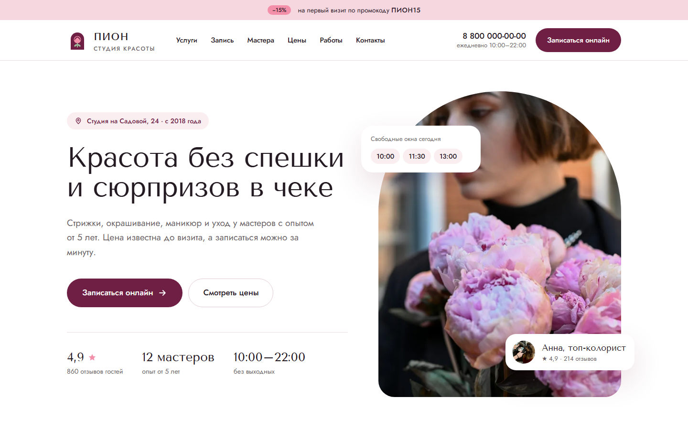
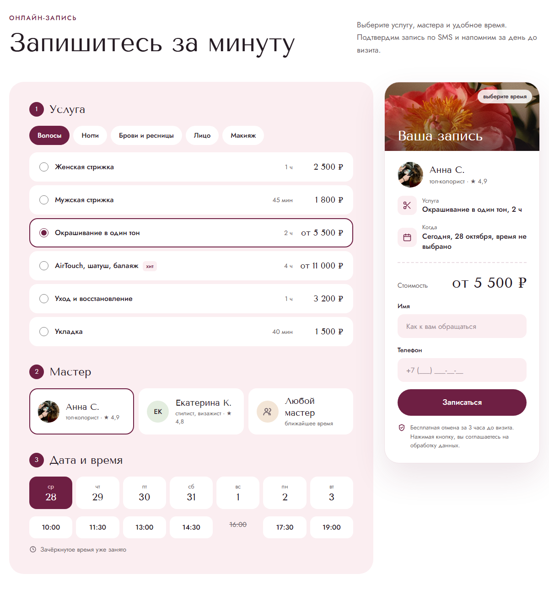
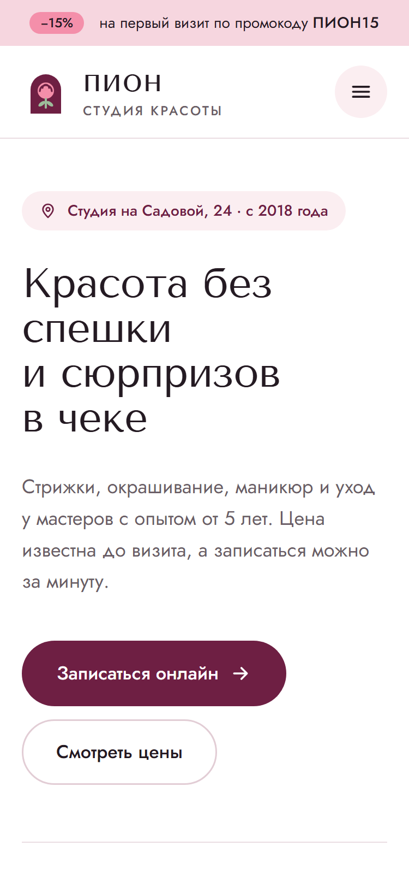

# «Пион»: лендинг студии красоты с онлайн-записью

Концепт для портфолио в нише, с которой я работал на заказах: красота и онлайн-запись. Студия, мастера,
цены и отзывы вымышлены, записи никуда не отправляются.

**Демо:** https://karelin-dev.github.io/beauty-salon/



| Онлайн-запись | Мобильная версия |
|---|---|
|  |  |

## Задача

Онлайн-запись, чтобы гости записывались сами, без звонка администратору: выбирали услугу,
мастера и свободное время. Расписание учитывает длительность услуги и время закрытия,
поэтому накладок у мастеров нет.

## Что сделано

- **Дизайн с нуля.** Название, логотип, палитра, подбор шрифтов (Jost и Tenor Sans),
  макет десктопа и логотипа. Вёрстка повторяет макет.
- **Онлайн-запись в три шага.** Категория и услуга, мастер, дата и время, справа «билет»
  с итогом, который обновляется на каждом шаге.
  - Мастера фильтруются по услуге: AirTouch делает только колорист, мужскую стрижку
    мужской стилист. Если мастеров несколько, есть вариант «Любой мастер».
  - Даты на 7 дней вперёд от сегодняшнего дня. Время с шагом 90 минут, слоты, после
    которых услуга не успеет закончиться до закрытия, не показываются.
    На сегодня прошедшее время скрыто.
  - Занятость детерминированная (хеш «мастер + дата + время»), у «Любого мастера»
    слот свободен, если свободен хотя бы один. После записи слот становится занятым.
  - Валидация: без выбранного времени, имени и телефона запись не уйдёт, ошибки
    понятным текстом рядом с полем.
  - Расписание вынесено в чистые функции (`getSlots`, `getDays`): их легко заменить
    запросом к API записи.
- **Связи между блоками.** «Записаться» у мастера, «Выбрать время» в прайсе и свободные
  окна на первом экране подставляют мастера, категорию или слот прямо в форму записи.
  Кнопка «Купить сертификат» меняет заголовок и тему формы обратного звонка.
- **Прайс на вкладках** по паттерну ARIA tabs: стрелки, Home, End. Прайс и форма записи
  строятся из одних данных (`data.js`), цены и длительности не расходятся.
- **Формы.** Маска телефона, валидация, сбор UTM-меток, одна точка подключения
  к API или CRM (`LEAD_ENDPOINT`).
- **Доступность.** Настоящие `radio` под карточками выбора, видимый фокус, `fieldset`
  и `legend` у шагов, `aria-live` у итога, контраст по WCAG AA, `prefers-reduced-motion`,
  ссылка «Перейти к содержимому».
- **Производительность.** Фото в WebP, `srcset` у главного фото, ленивая загрузка
  ниже первого экрана, размеры у всех картинок (нет сдвигов вёрстки).

**Lighthouse на GitHub Pages:** мобильная версия 98 / 100 / 100 / 100,
десктоп 95 / 100 / 100 / 100 (производительность, доступность, Best Practices, SEO).

## Стек

HTML, Tailwind CSS 4 (CLI, тема и компоненты в `src/styles.css`), JavaScript без
библиотек на ES-модулях, BrowserSync. Иконки SVG-спрайтом, фото с Unsplash
(авторы в [CREDITS.md](CREDITS.md)).

## Запуск

```bash
npm install
npm run dev     # сервер разработки на http://localhost:3001
npm run build   # сборка CSS в docs/, оттуда сайт публикует GitHub Pages
```

## Структура

```
src/
  styles.css        # тема Tailwind: цвета, шрифты, кнопки, чипы, поля
docs/               # сайт для GitHub Pages
  index.html
  css/main.css      # собранный Tailwind
  js/
    data.js         # категории, услуги, мастера
    schedule.js     # даты, слоты, занятость
    booking.js      # онлайн-запись
    prices.js       # прайс на вкладках
    hero.js         # свободные окна на первом экране
    forms.js        # маска телефона, валидация, отправка
    menu.js         # мобильное меню
    format.js       # цены, длительность, даты по-русски
    main.js         # инициализация
  img/              # фото в WebP
```

## Подключение отправки записей

В `docs/js/forms.js` укажите адрес в `LEAD_ENDPOINT`. Форма записи отправит POST с JSON:

```json
{
  "service": "Окрашивание в один тон",
  "price": 5500,
  "master": "Анна С.",
  "date": "2026-10-29",
  "time": "11:30",
  "name": "Ирина",
  "phone": "+79161234567",
  "form": "booking",
  "page": "https://example.com/?utm_source=vk",
  "utm": { "utm_source": "vk" },
  "createdAt": "2026-10-28T09:12:44.512Z"
}
```

Пока `LEAD_ENDPOINT` не задан, запись выводится в консоль браузера.

## Автор

Иван Карелин, [github.com/karelin-dev](https://github.com/karelin-dev)
